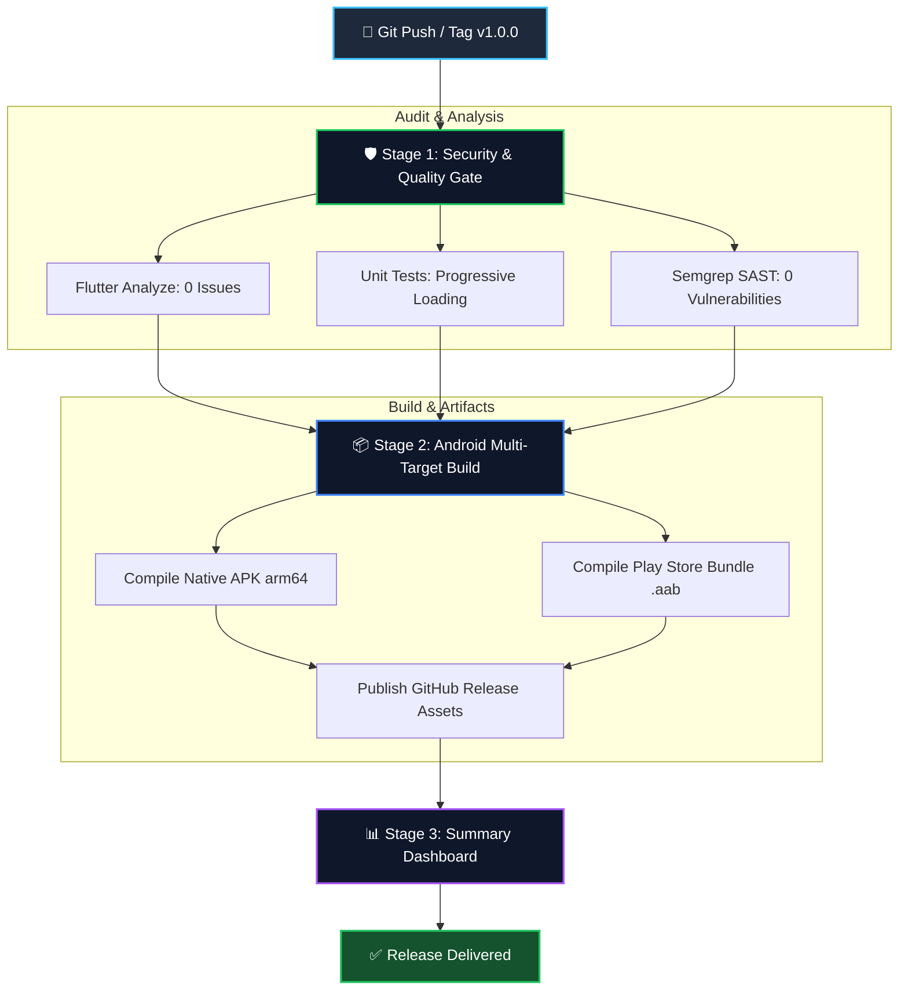

# AK Reader

A tactile wooden desk PDF reader built with Flutter.

## Features
- Realistic Wooden Desk Frame with authentic tap audio.
- Dynamic 3D Page Curl with angle tilt and dynamic touch physics.
- Physical Satin Ribbon Bookmark with complementary opposite-color notes.
- Real first-page thumbnail cover previews on bookshelf.
- Selective book pop-scale effect (1.05x) and dedicated delete controls.
- Full stationery suite (Pen, Pencil, Highlighter, Eraser) with 1:1 precision.

## 🔄 Automated CI/CD Architecture

## 🔄 Automated CI/CD Architecture

## 🔄 Automated CI/CD Architecture

## 🔄 Automated CI/CD Architecture

